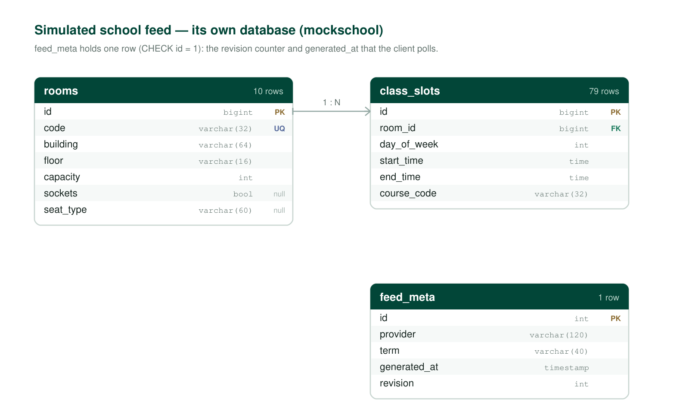

# Database schema

Two databases, one per service. Both diagrams were rendered **from the live schema** (columns,
keys and constraints read out of PostgreSQL), not from the migration files, so what you see is
what the running system actually has.

---

## 1. The project database — `emptyclassroom`

Seven tables. `flyway_schema_history` is left out on purpose: it is Flyway's own bookkeeping, not
part of the model.

| Table | What it holds | Rows now |
|---|---|---|
| `rooms` | one row per teaching room; `code` is unique | 10 |
| `class_slots` | the school timetable: which room, which weekday, which block, which course | 100 |
| `room_updates` | a change an administrator published (use / release), with a reason and an optional expiry | 7 |
| `room_reviews` | one review per person per room | 6 |
| `review_photos` | photos attached to a review; the file lives on disk, this table stores only the pointer | 2 |
| `app_user` | accounts and roles (`user` / `admin` / `superadmin`) | 6 |
| `audit_log` | append-only record of who changed what | 101 |

**How availability is derived.** There is no "free room" table. Free time is computed:
`class_slots` (the school's timetable) plus active `room_updates` (what staff added or released)
are subtracted from the teaching day, and the remainder is what the API answers with. That is why
the schema has no reservation table — nothing in this system can *own* a room.

### Things the diagram shows on purpose

- **`room_reviews.created_by`, `room_updates.created_by` and `audit_log.actor` are usernames stored as text — no foreign key.** That is a real limitation: deleting an account leaves its reviews pointing at a name with no row behind it. The alternative (a cascading FK) would delete people's reviews when an account is removed, which is worse for a review system. It is written down here rather than hidden.
- **`(room_id, created_by)` is unique together**, not on either column alone: one review per person per room. The diagram marks `created_by` with `UQ`; the pair is what actually holds.
- **`audit_log` references nothing.** `entity` + `entity_id` is a deliberate polymorphic reference, so the log survives the row it describes being deleted.
- **`CHECK (end_time > start_time)`** on both `class_slots` and `room_updates`: the database rejects an inverted block even if the service has a bug.
- **`review_photos.byte_size`** exists so the service can serve a `Content-Length` without touching the file, and `file_name` is unique because it is generated by the server (UUID + extension), never taken from the upload.

---

## 2. The simulated school feed — `mockschool`

Three tables, in a **separate PostgreSQL database** so the two systems share no storage — only the
HTTP contract.

| Table | What it holds |
|---|---|
| `rooms` | the rooms the feed publishes |
| `class_slots` | the timetable it publishes |
| `feed_meta` | exactly one row (`CHECK id = 1`): `provider`, `term`, `generated_at`, `revision` |

`feed_meta` is the point of the whole service. `generated_at` becomes `lastUpdated` in the API, so a
client can see how old the answer is; `revision` increments on every write, so a client can poll one
small endpoint and fetch the full timetable only when it changed.

---

## 3. What is deliberately not modelled

| Not there | Why |
|---|---|
| a `students` table | the university already owns identity; duplicating it would mean holding personal data this project has no reason to hold |
| a booking / reservation table | students do not book rooms — they look. Only staff publish changes, and those are `room_updates` |
| a `buildings` table | the building is a string on the room; there is no per-building attribute to store yet. A table would be a join for nothing |
| a room's live sensor state | the project answers from the timetable, not from occupancy sensors. Adding a column would imply a data source that does not exist |
