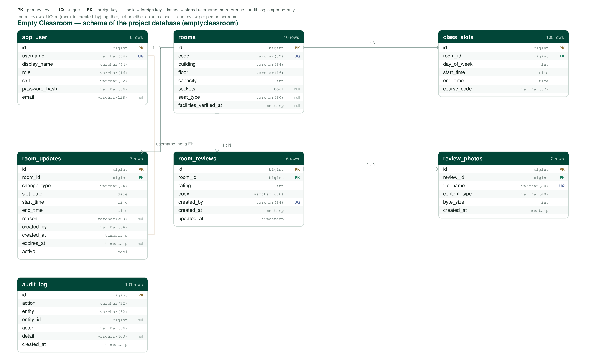

# 資料庫結構

兩個庫，一個服務一個。兩張 ER 圖都是**從跑著的資料庫讀出來的**（列、主鍵、約束直接查 PostgreSQL），不是照著遷移檔案畫的 —— 圖上就是系統真實的樣子。

---

## 1. 專案庫 —— `emptyclassroom`

七張表。`flyway_schema_history` 故意沒畫：那是 Flyway 自己的記帳，不屬於模型。

| 表 | 存什麼 | 現在多少行 |
|---|---|---|
| `rooms` | 每間教室一行；`code` 唯一 | 10 |
| `class_slots` | 學校課表：哪間房、周幾、哪個時段、哪門課 | 100 |
| `room_updates` | 管理員釋出的變更（佔用 / 釋放），帶原因和可選過期時間 | 7 |
| `room_reviews` | 每人每間房一條評價 | 6 |
| `review_photos` | 評價帶的照片；**檔案在磁碟，這張表只存指標** | 2 |
| `app_user` | 帳號與角色（`user` / `admin` / `superadmin`） | 6 |
| `audit_log` | 只追加的變更記錄 | 101 |

**空閒是怎麼算出來的。** 沒有"空閒教室"這張表。空閒是**算**出來的：把 `class_slots`（學校課表）加上生效中的 `room_updates`（員工加進去或釋放掉的）從教學日裡減掉，剩下的就是介面回答的內容。所以庫裡沒有預約表 —— 這個系統裡沒有任何東西能"佔用"一間房。

### 圖上特意畫出來的幾件事

- **`room_reviews.created_by`、`room_updates.created_by`、`audit_log.actor` 存的是使用者名稱文字，沒有外來鍵。** 這是真實的取捨：帳號刪掉後，評價會指向一個不存在的名字。換成級聯外來鍵則會連評價一起刪掉 —— 對評價系統更糟。寫在這裡而不是藏起來。
- **`(room_id, created_by)` 是**聯合**唯一**，不是各自唯一：每人每間房只能一條評價。圖上 UQ 標在 `created_by`，真正生效的是這兩列一起。
- **`audit_log` 不引用任何表。** `entity` + `entity_id` 是刻意的多型引用，這樣被記錄的那行刪掉了，日誌還留著。
- **`class_slots` 和 `room_updates` 都有 `CHECK (end_time > start_time)`** —— 就算服務層有 bug，資料庫也拒絕反著來的時間塊。
- **`review_photos.byte_size`** 讓服務不碰檔案就能給出 `Content-Length`；`file_name` 唯一，因為檔名是服務端生成的（UUID + 副檔名），從不採用上傳方的名字。

---

## 2. 模擬學校系統 —— `mockschool`

三張表，在**另一個 PostgreSQL 庫**裡 —— 兩個系統不共享儲存，只共享 HTTP 契約。

| 表 | 存什麼 |
|---|---|
| `rooms` | 這份資料釋出的教室 |
| `class_slots` | 釋出的課表 |
| `feed_meta` | 只有一行（`CHECK id = 1`）：`provider`、`term`、`generated_at`、`revision` |

`feed_meta` 是整個服務的關鍵。`generated_at` 變成介面裡的 `lastUpdated`，客戶端由此知道答案有多舊；`revision` 每次寫入加一，客戶端輪詢一個小介面就能判斷要不要拉全量課表。

---

## 3. 刻意沒有建模的東西

| 沒有 | 為什麼 |
|---|---|
| `students` 表 | 學生身份學校已經有了；複製一份等於多存一份本專案沒有理由持有的個人資料 |
| 預約 / 佔座表 | 學生不訂房，只是**查**。只有員工釋出變更，那就是 `room_updates` |
| `buildings` 表 | 樓名現在是房間上的一個字串，還沒有任何"按樓"的屬性要存；單獨建表只是一次沒意義的 join |
| 教室的實時佔用 | 專案回答的是課表，不是感測器。加這一列會暗示一個並不存在的資料來源 |
