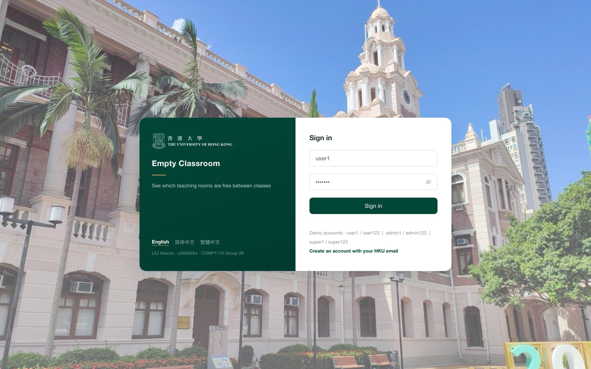
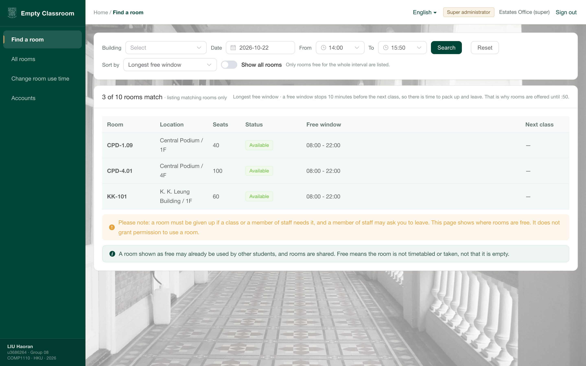
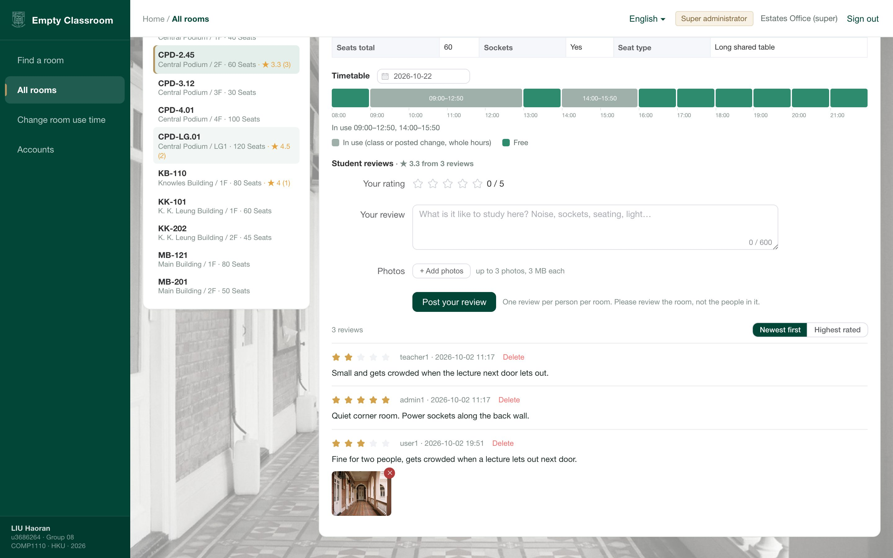
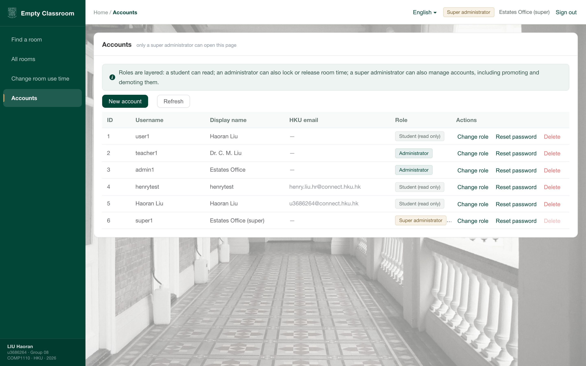
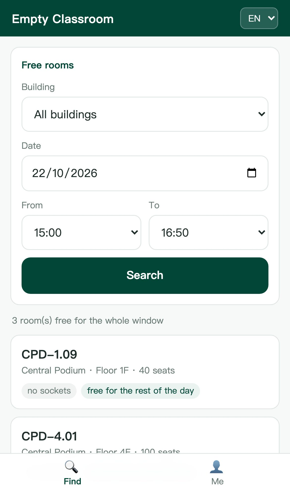
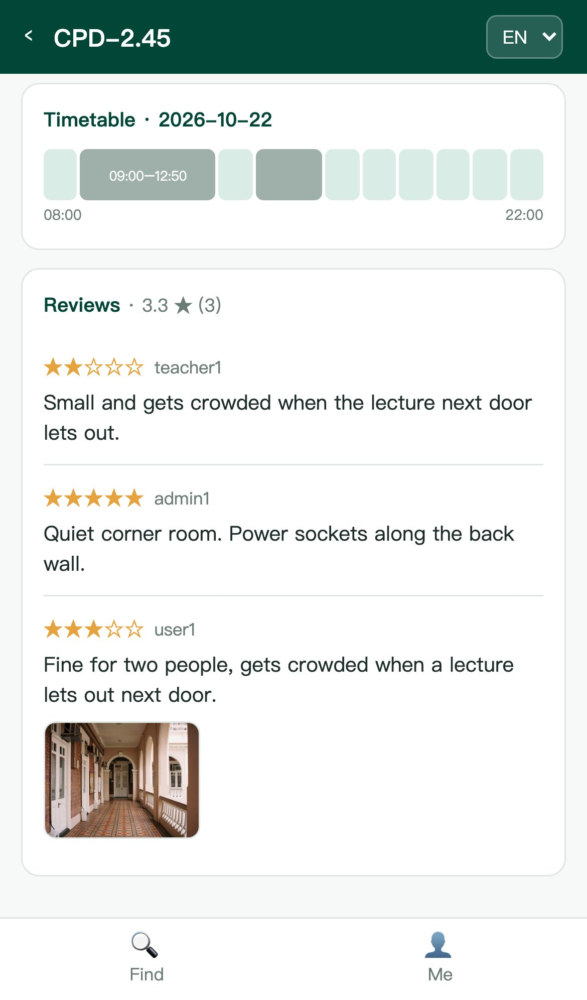
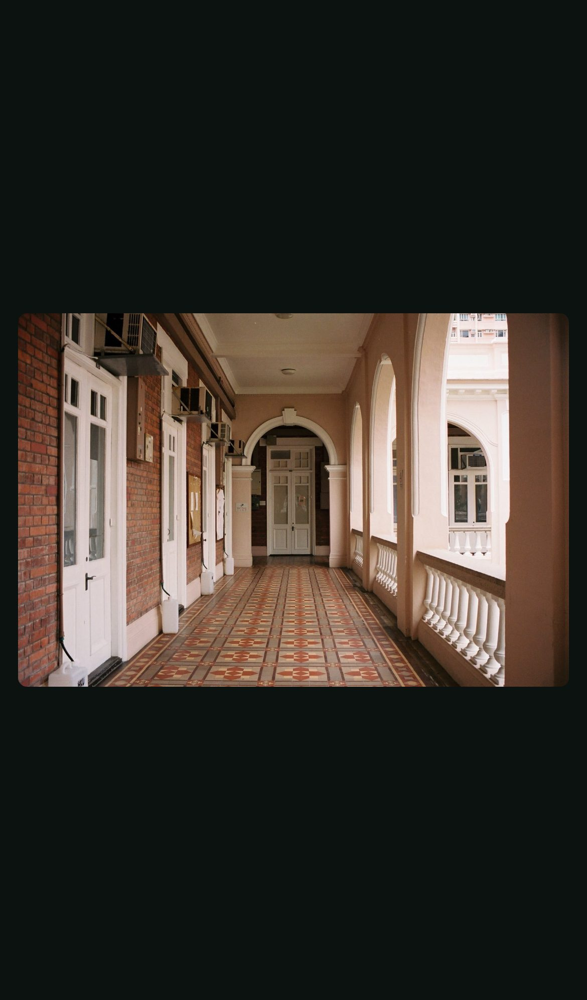
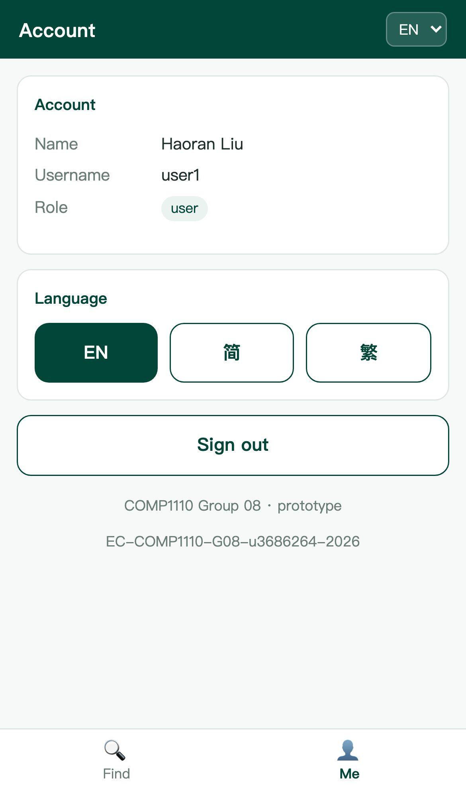
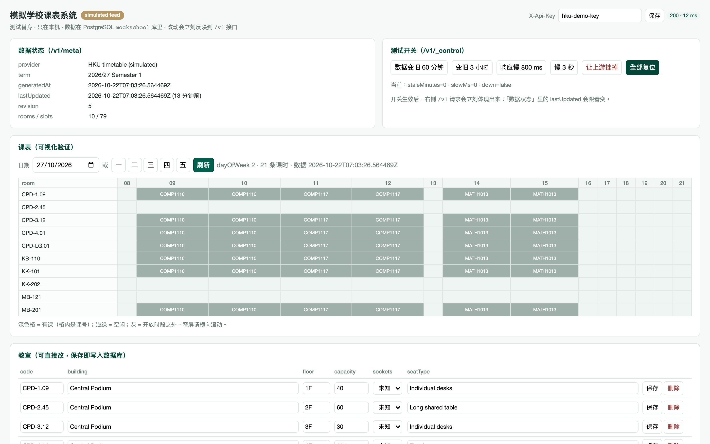

# 界面截图

**2026 年 10 月 22 日**从跑着的项目里截的，按系统里的不同部分分类。每张都是应用的真实截图，不是示意图。

---

## 1. 桌面端

1440 × 900 视口，2 倍像素，字更清楚。

| | |
|---|---|
| **登录** —— 三个角色共用一个登录 | **找空教室** —— 楼栋、日期、一个时间窗 |
|  |  |
| **教室与评价** —— 课表条、评价，其中一条带照片 | **账户管理** —— 只有超级管理员能进 |
|  |  |

看图时注意三点：课表条画的是**学校课表**，不是可预约的日历；最下面那条评价带的照片是**通过接口上传**的；账户页只有超级管理员能打开。

---

## 2. 手机端

iPhone 13 视口（390 × 844），**同一个后端**。

| | | |
|---|---|---|
| **找教室** —— 该时段 3 间空闲 | **教室页** —— 课表条 + 评价 | **点开照片** —— 全屏 |
|  |  |  |

| | |
|---|---|
| **我的** —— 账户、角色、语言 | |
|  | |

---

## 3. 模拟学校系统

一个独立服务，端口 9000，**自己的数据库**（`mockschool`）。它存在的意义是：让项目能对着"像学校系统的东西"做测试 —— 数据会变旧、响应会变慢、上游会挂。

控制台上能看到这份数据的 `revision` 和 `lastUpdated`；有把数据变旧、变慢、变不可用的开关；有课表网格做可视化核对；最下面是教室行，可以直接改（改完写进数据库并让 `revision` 加一）。

---

## 4. 架构图

| | |
|---|---|
| **两个系统，一份契约** —— 应用怎么调这份数据 | [two-systems-architecture-en.png](../mock-school-api/design/figures/two-systems-architecture-en.png) |
| **整体架构** | [architecture.png](diagrams/architecture.png) |
