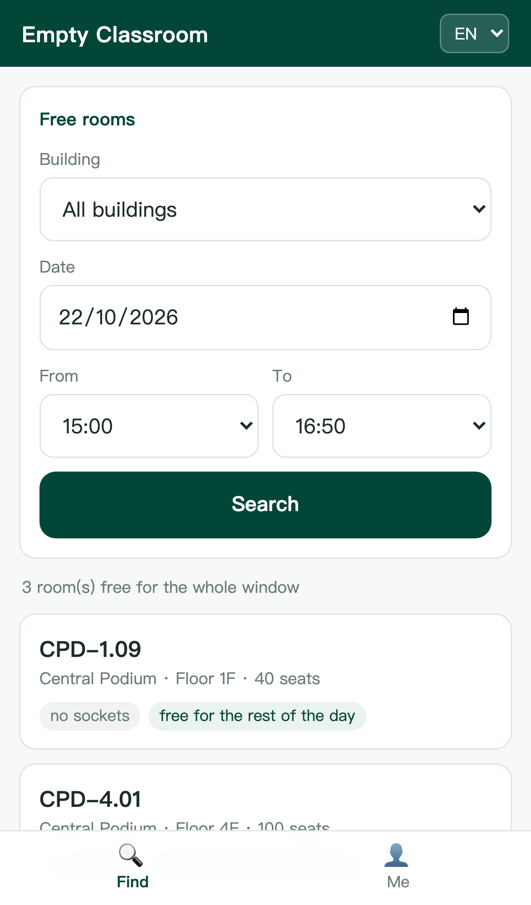
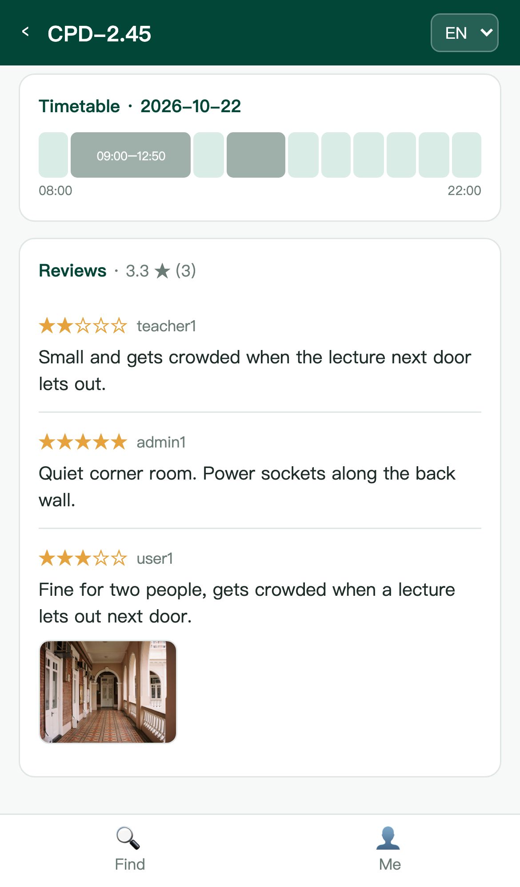
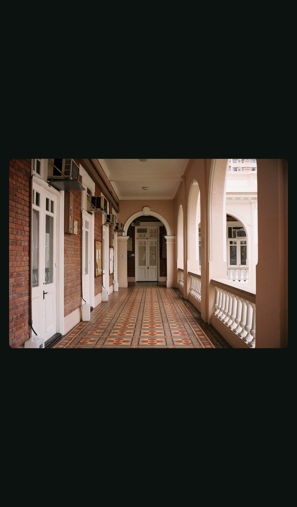

# mobile/ — the phone client

A second front end for the **same backend**. Nothing on the server knows this app exists: it
sends the same token to the same `/api` end points.

- **Vue 3 + Vite**, no component library (hand-written CSS keeps the bundle at ~160 KB)
- Port **5174**; `/api` is proxied to `8080` by the dev server, so there is no CORS change
  and no second copy of the business rules
- Three languages: English / 简体 / 繁體

## Run

```bash
cd mobile
npm install
npm run dev      # http://localhost:5174
```

The backend has to be running (`./scripts/start-all.sh` or `./scripts/start-backend.sh`).

Demo account: `user1` / `user123`.

## Screens

| Screen | What it does |
|---|---|
| Sign in | HKU email or username + password, same `/auth/login` as the desktop app |
| Find | building + date + a window (`from` on the hour, `to` on `:50`), then cards for the rooms free for the whole window |
| Room | details, a one-day timetable strip (grey = in use, pale green = free), reviews with photos — tap a photo to open it full screen |
| Me | account, role, language, sign out |

Administrator work (locking rooms, editing facilities, managing accounts) stays on the desktop
client: it is not a one-thumb task, and hiding it here keeps the mobile app a student view.

| Find | Room | Photo, tapped |
|---|---|---|
|  |  |  |

## Verified

Driven with Playwright in an iPhone 13 viewport (`390 × 844`, DPR 3):

- sign in as `user1`, then the search returns 3 rooms free for 15:00–16:50 on 2026-10-22
- `KB-110`: 10 timetable cells, 2 blocked (09:00–12:50 and 14:00–15:50), 1 review
- `CPD-2.45`: review photo renders at 104 × 78, decoded 1600 × 1081, 0 failed requests;
  tapping it opens a full-screen view (366 × 247 contained) and tapping again closes it
- language switch to 简体 changes the UI (`空闲教室`), 0 JavaScript errors
- `npm run build` clean: 161 KB JS (61 KB gzip) + 4 KB CSS
